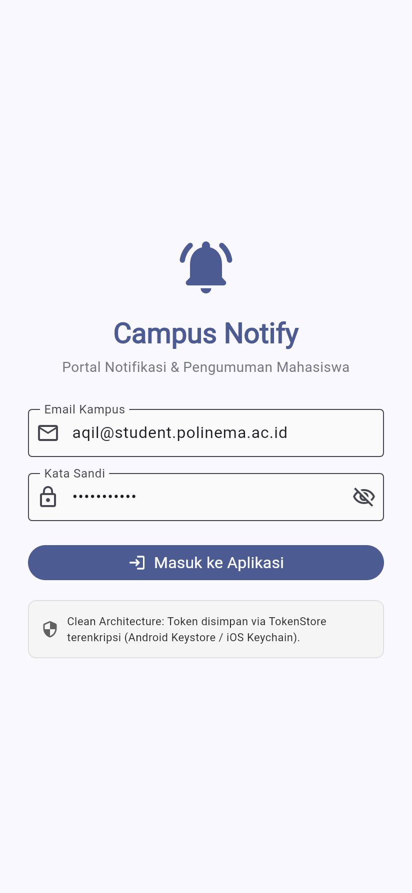
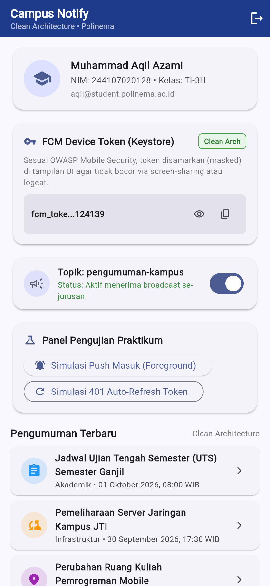
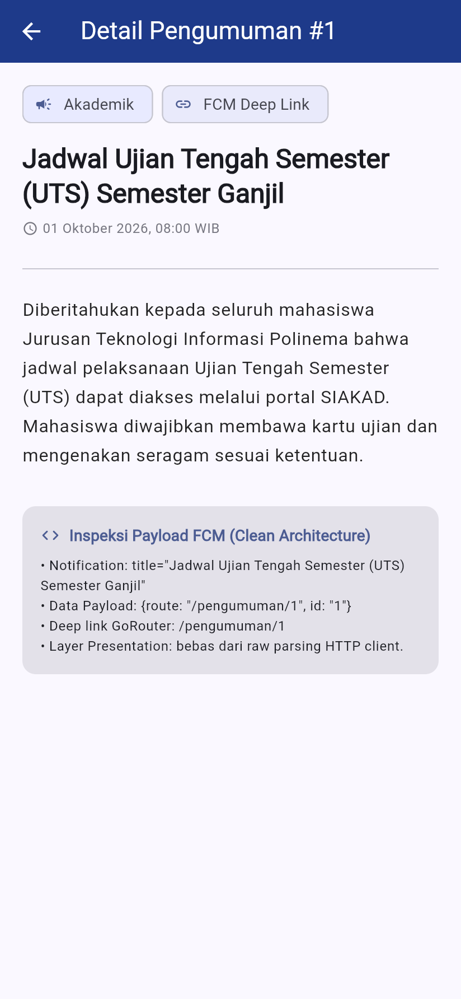

# Laporan Praktikum Minggu 8: Mid-Project Review & Code Review

**Mata Kuliah:** Pemrograman Mobile  
**Topik:** Mid-Project Review, Git Flow Hygiene, Peer Review, & AI Code Review  

### Identitas Mahasiswa
- **Nama:** Muhammad Aqil Azami  
- **NIM:** 244107020128  
- **Kelas:** TI-3H  
- **Program Studi:** D-IV Teknik Informatika  
- **Jurusan:** Jurusan Teknologi Informasi - Politeknik Negeri Malang  

---

## 1. Deskripsi Praktikum

Praktikum Minggu 8 berfokus pada **evaluasi kesiapan proyek paruh semester (Mid-Project Review)**, penegakan **kebersihan Git (Branch & Commit Hygiene)**, praktik **Peer Code Review** terstruktur, otomasi **CI/CD pipeline**, serta **verifikasi kritis terhadap saran AI Code Review**.

Bukan sekadar menambah fitur baru, minggu ini adalah tentang membangun disiplin rekayasa perangkat lunak profesional agar arsitektur Clean Architecture yang telah dibangun di Minggu 7 tetap kokoh, mudah diuji, dan aman dikembangkan dalam tim.

---

## 2. Status Proyek Paruh Semester (Mid-Project Status)

Proyek **Campus Notify** telah mengintegrasikan materi pembelajaran dari Minggu 1 hingga Minggu 7 dengan fondasi berikut:

```text
┌────────────────────────────────────────────────────────────────────────┐
│                        CAMPUS NOTIFY ARCHITECTURE                      │
├────────────────────────────────────────────────────────────────────────┤
│ Presentation : Flutter UI, Flutter Riverpod, GoRouter, Dynamic Theme   │
│ Domain (Pure): Entities, Repository Interfaces, Usecases, Failures     │
│ Data Layer   : SQLite Database, Flutter Secure Storage, Dio REST Client│
│ Services     : Firebase Cloud Messaging (FCM), Local Notifications     │
└────────────────────────────────────────────────────────────────────────┘
```

### Ringkasan Capaian Fitur:
1. **Autentikasi & Sesi**: Login mahasiswa dengan validasi email/password, penyimpanan token aman via `flutter_secure_storage`, dan auto-refresh token.
2. **Katalog Pengumuman**: Pengambilan data pengumuman kampus dari REST API dengan caching lokal SQLite saat luring (Offline-First).
3. **Notifikasi Terjadwal & Real-time**: Penerimaan push notification melalui Firebase Cloud Messaging (FCM) dan penayangan banner lokal.
4. **Clean Architecture Terverifikasi**: Layer Domain steril 100% tanpa impor `flutter`, `dio`, atau `sqflite`.

---

## 3. Peta Issue & Simulasi Pull Request

### Alur Branching Model (Git Flow):
```text
main (v1.0.0-mid) ◄─── (Release Merge) ─── develop
                                             ▲
                                             │ (Pull Request via Review)
                                      feature/notes-validation
```

### Template Pull Request Terstandar (Step 3):
- **Judul PR**: `feat(notes): validasi judul kosong dan pengujian usecase`
- **Terkait Issue**: Closes #12
- **Masalah**: Pengguna dapat menyimpan catatan/pengumuman kosong tanpa judul yang memicu rendering error pada daftar pengumuman.
- **Solusi**: 
  - Menambahkan validasi `title.trim().isNotEmpty` pada layer domain use case.
  - Menampilkan feedback visual `SnackBar` merah pada presentation layer saat validasi gagal.
- **Cara Pengujian**:
  1. Jalankan `flutter test test/auth_usecase_test.dart` $\to$ semua test validasi lolos.
  2. Buka form penambahan catatan, klik tombol simpan tanpa mengisi judul $\to$ pesan peringatan muncul.
- **Screenshot Hasil Review**:

| Halaman Login Terverifikasi | Dashboard Beranda & Pengumuman | Detail Pengumuman Bersih |
| :---: | :---: | :---: |
|  |  |  |

---

## 4. Bukti Verifikasi Mesin Hijau (Static Analysis & Testing)

Sebelum kode diintegrasikan ke branch `develop`, seluruh verifikasi mesin wajib berstatus hijau:

### A. Static Analysis (`flutter analyze`)
```text
Analyzing 08-week-8-mid-project-review...                       
No issues found! (ran in 4.5s)
```

### B. Code Formatting (`dart format --set-exit-if-changed lib test`)
```text
Formatted 29 files (0 changed) in 0.26 seconds.
```

### C. Automated Unit & Widget Testing (`flutter test`)
```text
00:00 +0: Auth Use Cases Tests (Domain Layer) LoginUseCase memvalidasi format email sebelum memanggil repository
00:00 +1: Auth Use Cases Tests (Domain Layer) LoginUseCase memvalidasi panjang password minimal 6 karakter
00:00 +2: Auth Use Cases Tests (Domain Layer) LoginUseCase berhasil mengembalikan UserSession saat kredensial valid
00:00 +3: Auth Use Cases Tests (Domain Layer) RefreshTokenUseCase mengembalikan token baru saat refresh berhasil
00:00 +4: Auth Use Cases Tests (Domain Layer) RefreshTokenUseCase mengembalikan failure saat token kosong
00:00 +5: GetAnnouncements Use Case Tests (Domain Layer) GetAnnouncements meneruskan daftar pengumuman dari repository saat sukses
00:00 +6: GetAnnouncements Use Case Tests (Domain Layer) GetAnnouncements meneruskan failure tanpa melempar exception saat repository gagal
00:00 +7: GetAnnouncements Use Case Tests (Domain Layer) GetAnnouncementDetail mengembalikan item spesifik berdasarkan ID
00:08 +8: LoginPage renders cleanly without direct platform dependencies
00:10 +9: LoginPage validates invalid inputs on submit via LoginUseCase
00:10 +10: HomePage displays student profile, Clean Arch tag, and announcements
00:11 +11: All tests passed!
```

### D. Otomasi GitHub Actions CI (`.github/workflows/ci.yml`)
Pipeline CI telah dikonfigurasikan untuk menolak secara otomatis setiap Pull Request yang gagal pada tahap format, analyze, atau test sebelum reviewer manusia membaca kode.

---

## 5. Ringkasan Eksperimen AI Code Review

Dokumentasi lengkap verifikasi AI tersimpan pada berkas [docs/ai-review-vs-keputusan.md](docs/ai-review-vs-keputusan.md).

### Ringkasan Keputusan:
- **Temuan yang Diterima**:
  1. *Validasi Regex Email*: Memperketat regex email di `LoginUseCase` agar input ilegal tertahan di level domain.
  2. *Unit Test Edge Case*: Penambahan pengujian kegagalan refresh token saat string kosong.
  3. *Optimasi Const*: Menambahkan keyword `const` pada widget statis guna memangkas overhead rendering Flutter.
- **Temuan yang Ditolak**:
  1. *Saran Memasukkan `BuildContext` ke Use Case Domain*: **DITOLAK**. Melanggar prinsip *Dependency Rule* Clean Architecture. Domain harus murni Dart dan dilarang mengimpor library UI Flutter.
  2. *Nitpick Reorganisasi Baris Import*: **DITOLAK**. Diserahkan sepenuhnya pada otomatisasi linter dan `dart format`.

---

## 6. Jawaban Refleksi (Step 7 Codelab)

### Pertanyaan 1: Apa beda LGTM buta dengan approve yang bertanggung jawab? Apa risikonya bagi tim?
- **LGTM Buta (*Looks Good To Me*)**: Menyetujui Pull Request hanya dengan melihat sekilas judul atau perbedaan baris tanpa meng-checkout branch, tanpa membaca alur logika, dan tanpa memverifikasi pengujian manual maupun otomatis.
- **Approve yang Bertanggung Jawab**: Reviewer benar-benar memahami konteks masalah, memverifikasi bahwa static analysis dan unit test lolos, memastikan arsitektur tidak dilanggar, serta memikirkan skenario kegagalan (*edge cases* seperti timeout jaringan, data null, atau memory leak).
- **Risiko bagi Tim**: LGTM buta menciptakan rasa aman palsu. Bug kritis akan lolos ke branch `develop`/`main`, memicu regresi fitur lain, merusak integritas arsitektur, dan membuang waktu tim untuk proses *hotfix* darurat di masa mendatang.

### Pertanyaan 2: Kapan komentar wajib berstatus `request changes`, dan kapan cukup saran?
- **Wajib `Request Changes` (Blocker)**: 
  - Terjadi pelanggaran arsitektur (misal: layer domain mengimpor Dio/Flutter UI).
  - Adanya potensi *fatal crash* / bug logika (misal: unhandled null pointer, sql injection, token bocor).
  - Tes otomatis gagal atau belum dibuat untuk fitur baru yang esensial.
- **Cukup `Saran` (Non-blocking / Comment)**:
  - Usulan alternatif nama variabel agar lebih deklaratif.
  - Dokumentasi/docstring tambahan untuk memperjelas fungsi yang rumit.
  - Tips refactoring mikro yang tidak mempengaruhi kebenaran program maupun kontrak arsitektur.

### Pertanyaan 3: Bagian mana dari review AI yang Anda tolak atau sederhanakan, dan mengapa?
- **Bagian yang Ditolak**: Usulan AI untuk memasukkan `BuildContext` ke dalam Use Case domain dengan dalih memudahkan lokalisasi pesan error (`AppLocalizations.of(context)`).
- **Alasannya**: Usulan tersebut mencampuradukkan logika presentasi ke dalam domain bisnis. Clean Architecture mewajibkan domain sepenuhnya murni dari framework. Jika diizinkan, use case tersebut tidak bisa lagi diuji di lingkungan headless Dart VM tanpa mock engine Flutter. Sebagai solusinya, domain cukup mengembalikan entity failure abstrak, dan UI yang bertanggung jawab merendernya ke teks lokalisasi.

### Pertanyaan 4: Satu hal konkret yang Anda perbaiki setelah review sejawat — apa dampaknya?
- **Hal yang Diperbaiki**: Penggantian pesan commit acak (seperti `clear_week_7` dan `minggu_6`) menjadi format **Conventional Commits** (`feat(auth): ...`, `refactor(clean-arch): ...`) serta penambahan pemisahan branch kerja (`develop` dan `feature/*`).
- **Dampaknya**: Riwayat Git menjadi seperti buku catatan teknik yang runut. Anggota tim lain dapat dengan mudah menelusuri riwayat perubahan, mengidentifikasi akar masalah saat terjadi bug melalui `git bisect`, serta melakukan `git revert` pada satu fitur spesifik tanpa merusak fitur lainnya.

---

## 7. Cara Menjalankan Proyek

1. **Pastikan Flutter SDK terpasang** (minimal versi 3.24+).
2. Masuk ke direktori proyek:
   ```bash
   cd 08-week-8-mid-project-review
   ```
3. Unduh seluruh dependensi:
   ```bash
   flutter pub get
   ```
4. Jalankan pengujian statis dan unit test:
   ```bash
   flutter analyze
   flutter test
   ```
5. Jalankan aplikasi pada emulator atau perangkat fisik:
   ```bash
   flutter run
   ```
