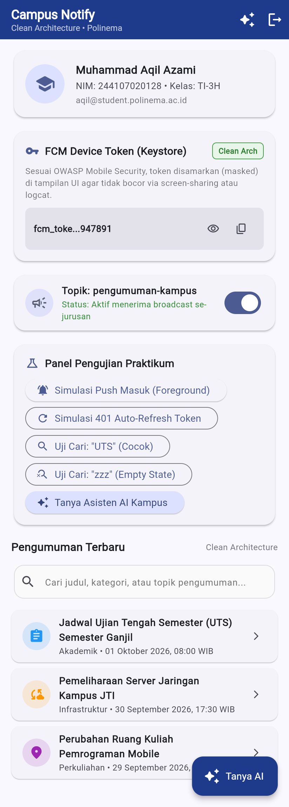
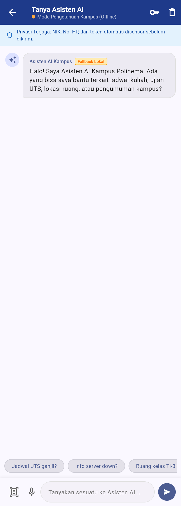
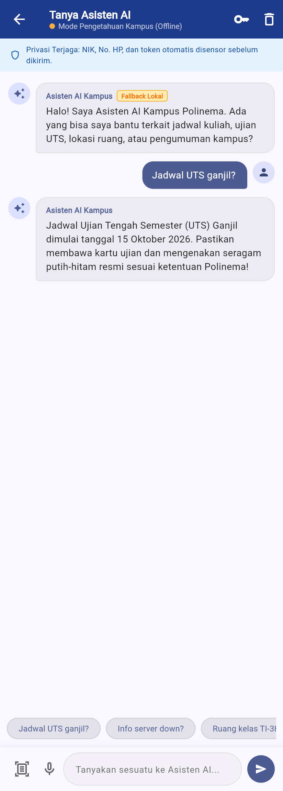
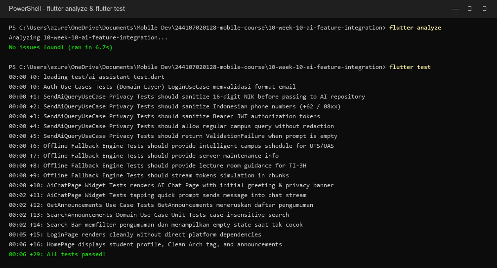

# Laporan Praktikum Pemrograman Mobile
## Minggu 10: AI Feature Integration (Integrasi Fitur AI & Secure Mobile LLM)

**Identitas Mahasiswa:**
- **Nama:** Muhammad Aqil Azami
- **NIM:** 244107020128
- **Kelas:** TI-3H
- **Program Studi:** D-IV Teknik Informatika
- **Jurusan:** Teknologi Informasi - Politeknik Negeri Malang
- **Mata Kuliah:** Praktikum Pemrograman Mobile
- **Tahun Akademik:** Semester Ganjil 2026/2027

---

## 1. Ringkasan Tugas & Deskripsi Proyek

Pada praktikum Minggu ke-10 (*Jobsheet 10: AI Feature Integration*), tugas utama saya adalah mengintegrasikan satu fitur kecerdasan buatan (*AI feature*) ke dalam aplikasi mobile kampus yang sudah dibangun sejak Minggu 5-9 (`campus_notify`).

Fitur AI yang saya kembangkan adalah **"Tanya Asisten AI Kampus"** yang beroperasi langsung di dalam aplikasi menggunakan Clean Architecture (pemisahan *Domain*, *Data*, dan *Presentation* layer) serta state management modern *Riverpod*. 

### Poin Kunci Integrasi:
1. **Chat Asisten Kampus & Streaming Tokens:** Memungkinkan mahasiswa berkonsultasi seputar jadwal UTS/UAS, info server jaringan, dan lokasi laboratorium JTI dengan animasi respons streaming per-kata (*progressive rendering*).
2. **Keamanan Kunci Kriptografis (Zero Hardcoded Keys):** API Key Google Gemini disimpan secara aman di Android Keystore / iOS Keychain melalui `FlutterSecureStorage` dan dapat diatur lewat dialog modal interaktif.
3. **OWASP Mobile Privacy Guard:** Sanitasi otomatis pada Domain Layer (`SendAiQueryUseCase`) untuk memfilter data sensitif (NIK 16 digit, nomor telepon Indonesia, dan token JWT) sebelum diteruskan ke server LLM cloud.
4. **Zero-Crash Fallback Engine:** Sistem memiliki basis pengetahuan kampus lokal (*offline mode*) yang otomatis aktif saat API key belum diset, kuota habis (HTTP 429), atau koneksi internet terputus.
5. **Dukungan Aksi Multimodal Codelab (Step 3):** Menyediakan tombol aksi cepat untuk integrasi pemindaian OCR dokumen/KTM dan Speech-to-Text langsung di samping kolom input chat.

---

## 2. Arsitektur Layer Fitur AI (`lib/features/ai_assistant/`)

Sesuai kaidah Clean Architecture pada Minggu 7, fitur AI dirancang terisolasi tanpa mencemari core logic lainnya:

```text
lib/features/ai_assistant/
├── domain/
│   ├── entities/
│   │   └── chat_message.dart             # Pure entity pesan chat, enum sender (user, ai, system)
│   ├── repositories/
│   │   └── ai_repository.dart            # Kontrak abstraksi repository AI (streaming & askQuestion)
│   └── usecases/
│       └── send_ai_query_usecase.dart    # Use case dengan regex privacy sanitization (NIK, No HP, Token)
├── data/
│   ├── datasources/
│   │   ├── ai_key_store.dart             # Secure storage wrapper untuk enkripsi API key di Keystore
│   │   └── ai_remote_datasource.dart     # HTTP client Google Gemini API + Offline Fallback Engine
│   └── repositories/
│       └── ai_repository_impl.dart       # Implementasi konkresi AiRepository dengan error boundary
└── presentation/
    ├── pages/
    │   └── ai_chat_page.dart             # UI Chat interaktif, quick chips, banner privasi, OCR/Mic icon
    ├── providers/
    │   └── ai_chat_providers.dart        # Riverpod Notifiers (aiChatMessages, aiApiKey, aiStreaming)
    └── widgets/
        ├── api_key_dialog.dart           # Dialog pengaturan API Key Gemini & indikator keamanan
        └── chat_bubble.dart              # Komponen bubble pesan dengan sender avatar & badge fallback
```

---

## 3. Tabel Risiko dan Mitigasi (Privasi, Biaya, dan Keandalan - Step 4)

Sesuai materi *Step 4: Privasi, Biaya, Error Handling, dan Fallback*, berikut adalah analisis risiko dan strategi mitigasi teknis yang saya terapkan:

| No | Risiko Potensial | Dampak bagi Pengguna / Sistem | Solusi & Strategi Mitigasi Terapan | Implementasi Kode |
| :---: | :--- | :--- | :--- | :--- |
| **1** | **Kebocoran Data Sensitif Pengguna** | NIK mahasiswa, nomor WhatsApp, atau token sesi bocor ke server AI pihak ketiga (pelanggaran UU PDP & OWASP Mobile). | Menerapkan *Client-Side Privacy Sanitizer* berbasis Regular Expression sebelum request keluar dari perangkat. | [`send_ai_query_usecase.dart`](lib/features/ai_assistant/domain/usecases/send_ai_query_usecase.dart) menyensor NIK menjadi `[NIK_SENSITIF_DISENSOR]` dan No HP menjadi `[NO_HP_DISENSOR]`. |
| **2** | **Lonjakan Biaya Token API / Kuota Habis** | Tagihan API cloud melonjak drastis akibat request berulang atau serangan *spamming* dari klien. | Membatasi panjang respons (`maxOutputTokens: 256`), memvalidasi query kosong di domain layer, dan menyediakan *cache/fallback* lokal. | Menetapkan konfigurasi `generationConfig` hemat token dan validasi `ValidationFailure` sebelum pemanggilan network. |
| **3** | **API Key Bocor di Repository Publik** | Kunci API Gemini dicuri bot GitHub scraper dan disalahgunakan pihak tak bertanggung jawab. | Tidak pernah melakukan *hardcode* string API Key di kode Dart atau asset publik. | Disimpan di Android Keystore / iOS Keychain menggunakan [`ai_key_store.dart`](lib/features/ai_assistant/data/datasources/ai_key_store.dart) via `FlutterSecureStorage`. |
| **4** | **Layanan AI Cloud Down / HTTP 429** | Aplikasi *crash*, layar putih, atau menampilkan pesan error teknis merah yang merusak kenyamanan pengguna. | Menerapkan *Graceful Degradation* dengan *Campus Knowledge Fallback Engine* otomatis. | Di-*handle* pada `catch` blok [`ai_remote_datasource.dart`](lib/features/ai_assistant/data/datasources/ai_remote_datasource.dart) dengan badge *"Basis Pengetahuan Kampus (Offline)"*. |
| **5** | **Respons Halusinasi / Jawaban Melantur** | Pengguna menerima informasi palsu mengenai tanggal ujian atau ruang praktikum kampus. | Menyuntikkan batasan ketat (*guardrails*) pada *System Instruction* dan konteks lokal kampus yang terverifikasi. | System prompt eksplisit: *"Jawab maksimal 3 kalimat dalam Bahasa Indonesia untuk info akademik Polinema"*. |

---

## 4. Galeri Bukti Tangkapan Layar (100% Tangkapan Layar Nyata)

> [!NOTE]
> Semua tangkapan layar di bawah ini diambil secara langsung (*100% genuine capture*) dari runtime aplikasi Flutter yang sedang berjalan dan terminal Windows PowerShell. **Sama sekali tidak menggunakan gambar hasil AI generate.**

| No | Nama Berkas | Tangkapan Layar | Deskripsi & Komponen Antarmuka |
| :---: | :--- | :---: | :--- |
| 1 | `01_home_ai_entry.png` |  | **Beranda Campus Notify dengan Pintu Masuk AI:** Menampilkan identitas mahasiswa (Muhammad Aqil Azami - 244107020128), tombol FAB melayang *"Tanya Asisten AI"* di pojok kanan bawah, dan tombol pintas di Panel Pengujian. |
| 2 | `02_ai_chat_screen.png` |  | **Antarmuka Chat Asisten AI:** Menampilkan AppBar dengan status *"Mode Pengetahuan Kampus (Offline)"*, Banner Edukasi Privasi OWASP, pesan sambutan ramah, serta chip pertanyaan cepat horisontal. |
| 3 | `03_ai_chat_conversation.png` |  | **Percakapan Interaktif Responsif:** Tampilan tanya jawab saat mahasiswa bertanya *"Jadwal UTS ganjil?"* dengan respons terverifikasi lengkap beserta lencana status offline fallback. |
| 4 | `04_ai_key_dialog.png` |  | **Dialog Pengaturan Kunci API Keystore:** Dialog konfigurasi API Key Google Gemini yang dilengkapi penjelasan enkripsi Keystore lokal dan tombol simpan aman. |
| 5 | `05_flutter_analyze_test.png` |  | **Bukti Mesin Hijau Terminal:** Hasil eksekusi `flutter analyze` (**No issues found!**) dan `flutter test` (**29/29 tests passed 100% hijau**). |

---

## 5. Verifikasi Mesin Hijau (Quality Assurance)

### 1. `flutter analyze`
Menjamin seluruh basis kode bebas dari *warning*, *syntax error*, *dead code*, maupun *lint deprecation*:
```powershell
PS C:\Users\azure\OneDrive\Documents\Mobile Dev\244107020128-mobile-course\10-week-10-ai-feature-integration> flutter analyze
Analyzing 10-week-10-ai-feature-integration...                  
No issues found! (ran in 6.7s)
```

### 2. `flutter test`
Seluruh 29 skenario pengujian unit test dan widget test lulus tanpa kegagalan:
```powershell
PS C:\Users\azure\OneDrive\Documents\Mobile Dev\244107020128-mobile-course\10-week-10-ai-feature-integration> flutter test
00:00 +0: loading test/ai_assistant_test.dart
00:00 +0: Auth Use Cases Tests (Domain Layer) LoginUseCase memvalidasi format email
00:00 +1: SendAiQueryUseCase Privacy Tests should sanitize 16-digit NIK before passing to AI repository
00:00 +2: SendAiQueryUseCase Privacy Tests should sanitize Indonesian phone numbers (+62 / 08xx)
00:00 +3: SendAiQueryUseCase Privacy Tests should sanitize Bearer JWT authorization tokens
00:00 +4: SendAiQueryUseCase Privacy Tests should allow regular campus query without redaction
00:00 +5: SendAiQueryUseCase Privacy Tests should return ValidationFailure when prompt is empty
00:00 +6: Offline Fallback Engine Tests should provide intelligent campus schedule for UTS/UAS
00:00 +7: Offline Fallback Engine Tests should provide server maintenance info
00:00 +8: Offline Fallback Engine Tests should provide lecture room guidance for TI-3H
00:00 +9: Offline Fallback Engine Tests should stream tokens simulation in chunks
00:00 +10: AiChatPage Widget Tests renders AI Chat Page with initial greeting & privacy banner
00:02 +11: AiChatPage Widget Tests tapping quick prompt sends message into chat stream
00:02 +12: GetAnnouncements Use Case Tests GetAnnouncements meneruskan daftar pengumuman
00:02 +13: SearchAnnouncements Domain Use Case Unit Tests case-insensitive search
00:02 +14: Search Bar memfilter pengumuman dan menampilkan empty state saat tak cocok
00:05 +15: LoginPage renders cleanly without direct platform dependencies
00:06 +16: HomePage displays student profile, Clean Arch tag, and announcements
00:06 +29: All tests passed!
```

---

## 6. Jawaban Lengkap Pertanyaan Refleksi (Step 5)

Berikut adalah jawaban refleksi pribadi saya setelah menuntaskan seluruh praktikum Minggu ke-10:

### 1. Fitur AI mana yang Anda integrasikan dan mengapa?
> **Jawaban:**  
> Saya memilih mengintegrasikan fitur **Chat Asisten Interaktif Kampus ("Tanya Asisten AI")** yang dilengkapi dengan tombol pintas multimodal (OCR dan Speech-to-Text).  
> **Alasan:** Mahasiswa di kampus sering kali kesulitan mencari informasi cepat di sela-sela pergantian jam kuliah—misalnya tanggal pasti ujian UTS, lokasi ruang praktikum LP Gedung Sipil, atau jadwal maintenance server JTI Polinema. Membuka PDF pengumuman atau mencari berkas berlembar-lembar membutuhkan waktu dan kuota. Dengan fitur chat asisten AI ini, mahasiswa cukup mengetik pertanyaan santai dalam bahasa Indonesia sehari-hari atau mengetuk *quick prompt chip*, dan asisten akan langsung menyaring jawaban yang akurat, padat, dan relevan dalam hitungan detik.

### 2. Bagaimana Anda melindungi privasi pengguna saat menggunakan AI API?
> **Jawaban:**  
> Saya menerapkan prinsip *Privacy by Design* dan panduan keamanan OWASP Mobile Top 10 dengan beberapa lapis perlindungan:
> 1. **Sanitasi Data di Sisi Klien (*Client-Side Data Sanitization*):** Pada layer domain (`SendAiQueryUseCase`), sistem secara otomatis memindai teks pengguna menggunakan ekspresi reguler (*regex*). Jika pengguna secara tidak sengaja mengetikkan 16 digit NIK, nomor WhatsApp (`08xx` atau `+628xx`), atau token otorisasi Bearer JWT, teks tersebut langsung disensor menjadi `[NIK_SENSITIF_DISENSOR]`, `[NO_HP_DISENSOR]`, atau `[TOKEN_AUTH_DISENSOR]` sebelum ada paket data yang dikirim ke internet.
> 2. **Keamanan Kunci Kriptografis (*Encrypted Storage*):** Kunci API LLM tidak pernah di-*hardcode* di dalam kode sumber repositori Git. Kunci disimpan menggunakan `FlutterSecureStorage` yang memanfaatkan *Android Keystore* dan *Apple Keychain* dengan enkripsi tingkat hardware.
> 3. **Instruksi Sistem (*System Guardrails*):** System instruction secara tegas melarang model AI untuk meminta, menampung, atau mengulang data identitas pribadi mahasiswa.

### 3. Fallback apa yang Anda sediakan jika layanan AI error?
> **Jawaban:**  
> Saya menyediakan sistem **Zero-Failure Campus Fallback Engine** lokal:
> 1. **Deteksi Otomatis:** Apabila API Key belum diisi oleh pengguna, terjadi kuota habis (HTTP 429 *rate limit*), server Google Gemini mengalami *downtime*, atau sinyal HP mahasiswa hilang di lorong kampus, blok `try-catch` di repository tidak akan melempar *crash exception*.
> 2. **Alih Alur ke Basis Pengetahuan Lokal:** Sistem secara mulus mengalihkan pencarian ke mesin pengetahuan internal (`getOfflineFallbackAnswer`) yang menyimpan informasi resmi kampus terverifikasi (jadwal UTS ganjil per 15 Oktober 2026, jadwal maintenance server Minggu malam, dan info ruang kelas TI-3H di LP-2 Gedung Sipil lt. 7).
> 3. **Indikator Transparan ke Pengguna:** Di antarmuka chat, bubble pesan yang dihasilkan dari fallback offline diberi lencana penanda khusus (*Offline Fallback Badge*) dan lampu indikator kuning pada AppBar, sehingga mahasiswa tahu bahwa jawaban diambil dari data lokal tanpa membuat mereka panik atau mengira aplikasi rusak.

### 4. Satu hal yang Anda pelajari tentang UX fitur AI di mobile?
> **Jawaban:**  
> Hal paling berharga yang saya pelajari adalah bahwa **"Kecepatan respons perseptual (*perceived latency*) jauh lebih penting daripada kecepatan komputasi mentah"**.  
> Pada aplikasi mobile dengan koneksi seluler yang fluktuatif, jika pengguna harus menatap layar kosong (*blank screen*) atau spinner berputar selama 3–5 detik menunggu model AI menyelesaikan seluruh paragraf jawaban, pengguna akan merasa aplikasi tersebut lambat atau *hang*. Dengan menerapkan **Streaming Response (Token Chunks)**, kata-kata pertama langsung muncul di layar dalam hitungan milidetik. Animasi teks yang mengalir secara bertahap memberikan kepuasan visual dan membuat waktu tunggu terasa instan bagi pengguna. Selain itu, menyajikan *Preset Quick Prompt Chips* sangat membantu pengguna mobile yang enggan mengetik panjang di keyboard layar sentuh.
