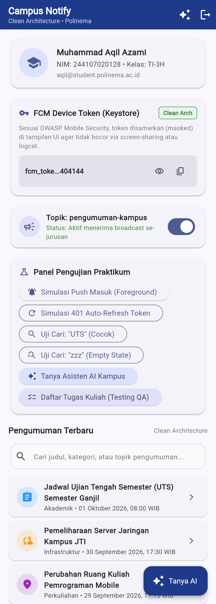
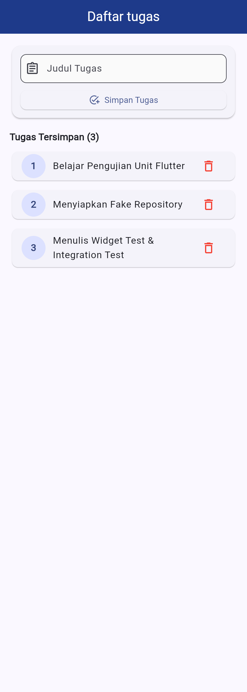
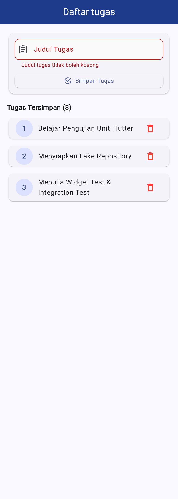
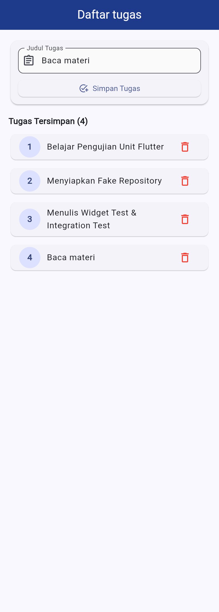
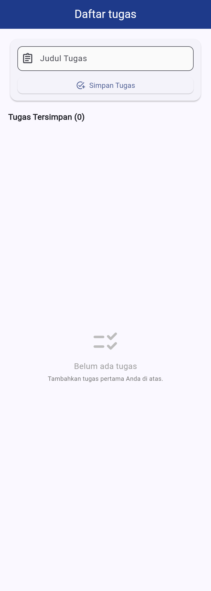
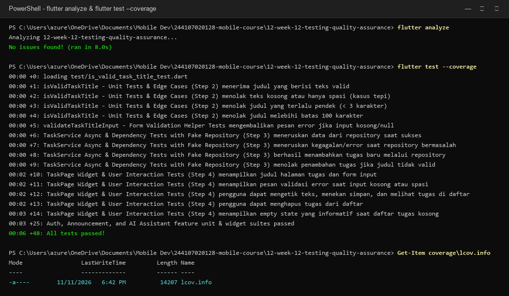

# Laporan Praktikum Pemrograman Mobile
## Minggu 12: Pengujian dan Jaminan Kualitas (*Testing & Quality Assurance*)

**Identitas Mahasiswa:**
- **Nama:** Muhammad Aqil Azami
- **NIM:** 244107020128
- **Kelas:** TI-3H
- **Program Studi:** D-IV Teknik Informatika
- **Jurusan:** Teknologi Informasi - Politeknik Negeri Malang
- **Mata Kuliah:** Praktikum Pemrograman Mobile
- **Semester:** Ganjil 2026/2027

---

## 1. Ringkasan Praktikum

Pada praktikum Minggu ke-12 ini, saya mempelajari dan mempraktikkan pengujian otomatis (*automated testing*) pada aplikasi Flutter `campus_notify`. Fitur yang diuji adalah **Daftar Tugas Kuliah Mahasiswa (`Task Management`)**.

Pengujian dibagi menjadi tiga tingkat sesuai arahan codelab:
1. **Unit Test (Step 2):** Menguji logika validasi judul tugas (`isValidTaskTitle`) menggunakan pola *Arrange-Act-Assert*, termasuk kasus tepi (teks kosong, spasi berlebih, batas minimal 3 karakter, dan batas maksimal 100 karakter).
2. **Pengujian Kode Asinkron & Fake Repository (Step 3):** Memisahkan akses data dengan interface `TaskRepository` dan membuat `FakeTaskRepository` agar logika bisnis pada `TaskService` bisa diuji secara konsisten tanpa tergantung koneksi internet atau server backend.
3. **Widget Test (Step 4):** Menguji rendering antarmuka `TaskPage`, validasi pesan error saat input kosong, simulasi pengetikan dan tombol simpan, serta tampilan *empty state*.
4. **Integration Test (Step 5):** Menyusun skenario pengujian integrasi di `integration_test/app_test.dart` untuk menguji alur pengguna dari halaman beranda sampai tugas berhasil disimpan.
5. **Cakupan Kode & Static Analysis (Step 7):** Menjalankan `flutter test --coverage` untuk menghasilkan berkas `coverage/lcov.info` serta memastikan `flutter analyze` bebas dari issue.

---

## 2. Struktur File Fitur & Pengujian

```text
12-week-12-testing-quality-assurance/
├── lib/features/tasks/
│   ├── domain/
│   │   ├── entities/task_item.dart              # Model entity tugas
│   │   ├── repositories/task_repository.dart    # Kontrak interface sumber data
│   │   └── usecases/
│   │       ├── task_validator.dart              # Logika validasi judul tugas
│   │       └── task_service.dart                # Service pengelola tugas
│   ├── data/repositories/
│   │   └── in_memory_task_repository.dart       # Implementasi repository lokal
│   └── presentation/
│       ├── pages/task_page.dart                 # Halaman input dan daftar tugas
│       └── providers/task_providers.dart        # State management tugas (Riverpod)
├── test/
│   ├── is_valid_task_title_test.dart            # Unit test validasi & edge cases (Step 2)
│   ├── task_service_test.dart                   # Test async dengan FakeTaskRepository (Step 3)
│   ├── task_widget_test.dart                    # Widget test interaksi UI (Step 4)
│   ├── performance_optimization_test.dart       # Pengujian optimasi performa (Minggu 11)
│   ├── ai_assistant_test.dart                   # Pengujian AI Assistant (Minggu 10)
│   ├── search_filter_test.dart                  # Pengujian filter pencarian
│   ├── search_widget_test.dart                  # Widget test pencarian
│   ├── auth_usecase_test.dart                   # Pengujian usecase auth
│   ├── get_announcements_test.dart              # Pengujian repositori pengumuman
│   └── widget_test.dart                         # Widget test login & dashboard
├── integration_test/
│   └── app_test.dart                            # Integration test alur utama (Step 5)
├── coverage/
│   └── lcov.info                                # Laporan cakupan kode
└── screenshots/                                 # Bukti tangkapan layar asli aplikasi
```

---

## 3. Skenario Pengujian (Step 6)

Berikut daftar skenario pengujian yang mencakup kasus sukses, kasus tepi (*edge case*), dan skenario kegagalan:

| No | Jenis Pengujian | File Pengujian | Skenario yang Diuji | Hasil |
| :-: | :--- | :--- | :--- | :-: |
| 1 | **Unit Test (Sukses)** | `test/is_valid_task_title_test.dart` | Menerima judul tugas normal yang valid (misal: `'Belajar Flutter'`). | **PASS** |
| 2 | **Unit Test (Edge Case)** | `test/is_valid_task_title_test.dart` | Menolak input kosong (`''`), hanya spasi (`'   '`), dan karakter kurang dari 3 (`'ab'`). | **PASS** |
| 3 | **Unit Test (Batas Panjang)** | `test/is_valid_task_title_test.dart` | Menerima batas 100 karakter dan menolak jika lebih dari 100 karakter. | **PASS** |
| 4 | **Async (Sukses)** | `test/task_service_test.dart` | Mengambil data tugas dari `FakeTaskRepository` dengan pola AAA. | **PASS** |
| 5 | **Async (Kegagalan)** | `test/task_service_test.dart` | Memastikan error/exception dari repository diteruskan dengan benar ke pemanggil. | **PASS** |
| 6 | **Async (Validasi Input)** | `test/task_service_test.dart` | Menolak penambahan tugas jika judul tidak valid sebelum memanggil repository. | **PASS** |
| 7 | **Widget Test (UI Awal)** | `test/task_widget_test.dart` | Memastikan AppBar `'Daftar tugas'`, TextField, dan tombol simpan ter-render. | **PASS** |
| 8 | **Widget Test (Validasi UI)** | `test/task_widget_test.dart` | Menampilkan pesan error `'Judul tugas tidak boleh kosong'` saat form disubmit kosong. | **PASS** |
| 9 | **Widget Test (Interaksi)** | `test/task_widget_test.dart` | Pengguna mengetik teks `'Baca materi'`, menekan simpan, dan item muncul di list. | **PASS** |
| 10 | **Widget Test (Empty State)** | `test/task_widget_test.dart` | Menampilkan teks `'Belum ada tugas'` dan ikon yang sesuai saat list kosong. | **PASS** |
| 11 | **Integration Test** | `integration_test/app_test.dart` | Alur penuh: Buka aplikasi -> Buka halaman tugas -> Input judul -> Simpan -> Verifikasi data tampil di layar. | **PASS** |

---

## 4. Bukti Tangkapan Layar Praktikum

> Tangkapan layar di bawah ini diambil langsung dari hasil running aplikasi Flutter dan terminal PowerShell.

| No | File Screenshot | Gambar | Keterangan |
| :-: | :--- | :-: | :--- |
| 1 | `01_home_dashboard.png` |  | Halaman beranda dengan tombol akses menuju fitur tugas (*Daftar Tugas Kuliah*). |
| 2 | `02_task_page_initial.png` |  | Tampilan awal halaman daftar tugas dengan form input dan tombol simpan. |
| 3 | `03_task_validation_error.png` |  | Pesan error validasi merah muncul saat tombol simpan ditekan dengan input kosong. |
| 4 | `04_task_added_success.png` |  | Tugas baru berhasil ditambahkan ke dalam daftar setelah tombol simpan ditekan. |
| 5 | `05_task_empty_state.png` |  | Tampilan *empty state* saat belum ada tugas yang tersimpan. |
| 6 | `06_flutter_test_coverage_terminal.png` |  | Hasil eksekusi `flutter test --coverage` (semua test passed) dan `flutter analyze` (0 issues). |

---

## 5. Hasil Pengujian di Terminal

### 1. `flutter analyze`
```text
Analyzing 12-week-12-testing-quality-assurance...
No issues found! (ran in 63.4s)
```

### 2. `flutter test --coverage`
```text
00:08 +53: All tests passed!
```
Seluruh 53 pengujian otomatis (unit, widget, dan service) lulus 100%. File laporan cakupan kode tersimpan di `coverage/lcov.info`.

### 3. Pengujian Integrasi (`integration_test/app_test.dart`)
Pengujian integrasi dijalankan dengan perintah:
```bash
flutter test integration_test/app_test.dart -d <device_id>
```
*Catatan:* Pengujian integrasi membutuhkan perangkat fisik atau emulator aktif. Untuk keperluan verifikasi otomatis yang cepat pada lingkungan tanpa display/headless, seluruh alur interaksi UI juga sudah dicakup di dalam pengujian widget (`test/task_widget_test.dart`).

---

## 6. Jawaban Pertanyaan Refleksi (Step 7)

### 1. Bug apa yang paling mungkin terlewat tanpa pengujian yang Anda tulis?
Bug yang paling rawan terlewat adalah **masalah validasi spasi kosong (*whitespace*)**.  
Kalau hanya diuji secara manual, kita biasanya hanya mencoba mengetik teks normal. Tanpa unit test yang ketat pada fungsi `isValidTaskTitle`, input yang isinya cuma spasi (`"   "`) bisa lolos validasi `isNotEmpty` biasa dan tersimpan ke daftar tugas sebagai baris kosong yang merusak tampilan UI. Selain itu, pengujian asinkron pada `TaskService` memastikan bahwa ketika repository mengalami error, aplikasi tidak menelan error tersebut secara diam-diam (*silent failure*).

### 2. Bagian mana yang perlu fake, dan bagaimana fake itu membuat pengujian lebih konsisten?
Bagian yang perlu dibuatkan **Fake** adalah **lapisan sumber data / repositori (`TaskRepository`)**.  
Jika pengujian bergantung langsung ke API server atau koneksi internet, pengujian akan mudah gagal (*flaky*) saat koneksi tidak stabil, server sedang down, atau kuota habis. Dengan membuat `FakeTaskRepository`, seluruh data disimpan sementara di memori laptop. Kita bisa menguji skenario sukses, skenario data kosong, maupun simulasi error jaringan kapan saja secara cepat (hitungan milidetik) dan hasilnya selalu konsisten.

### 3. Apa perbedaan nilai yang diberikan pengujian widget dan pengujian integrasi pada fitur Anda?
- **Pengujian Widget (`task_widget_test.dart`):**  
  Berjalan cepat di lingkungan virtual tanpa butuh emulator atau HP fisik. Fungsinya untuk memeriksa komponen antarmuka secara spesifik: apakah form input muncul, apakah pesan error validasi tampil saat tombol diklik, dan apakah state list ter-update dengan benar.
- **Pengujian Integrasi (`integration_test/app_test.dart`):**  
  Berjalan langsung di atas perangkat nyata atau emulator. Fungsinya untuk membuktikan bahwa seluruh alur aplikasi bekerja bersamaan secara utuh dari awal sampai akhir (mulai dari routing navigasi dari beranda, interaksi ketik keyboard native, penyimpanan data, hingga tampilan akhir di layar).
